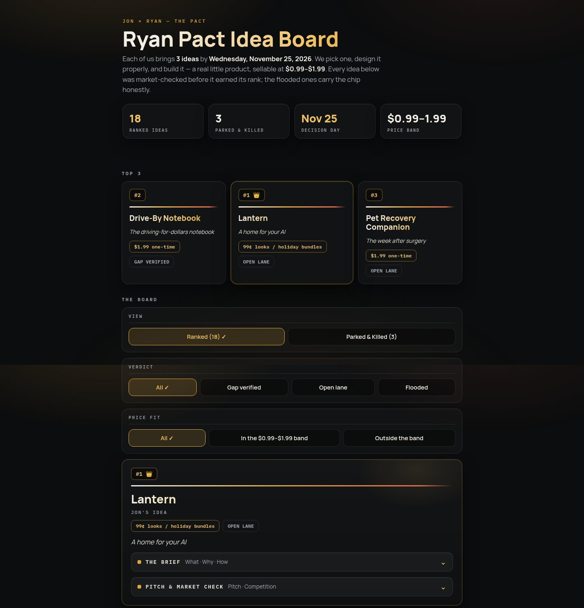

# Ryan Pact Idea Board

> Jon × Ryan — each brings 3 ideas by Wednesday, November 25, 2026. Pick one, design it, build it.

**Live preview:** https://vaultlabz.github.io/ryan-pact-idea-board/

Full-page screenshot: [media/full-page.jpg](media/full-page.jpg)

**Branch policy:** work happens on the latest *-vN / project branch. List branches before editing. Never assume the GitHub default is the working line. Working line: ryan-pact-idea-v2 (GitHub default is main). ryan-pact-idea-v1 is the frozen Nov 19 snapshot; main is the Pages serving line.

## What's inside

A read-only public snapshot of the live idea board Jon keeps in Muse (snapshot: November 19, 2026):

- **18 ranked ideas**, each market-checked before it earned its rank — with The Brief (What / Why / How in plain English), the full pitch, and the market check on every card
- **Top 3** spotlight row, verdict + price-fit filters, and a Parked & Killed view
- Honest verdicts throughout: gap verified, open lane, or flooded — the flooded ones carry the chip

## Design language

Deep charcoal + dark frosted glass, ivory text, warm gold/soft-red aurora accents (gradient titles, aurora color-bar rules), Manrope + IBM Plex Mono, rounded rectangles only. Group panels and segmented controls borrow the BookVizion settings look.

## Tech

| Piece | Choice |
|---|---|
| Page | Single static `index.html` (inline CSS + vanilla JS toggles/filters) |
| Fonts | Google Fonts — Manrope, IBM Plex Mono |
| Hosting | GitHub Pages from `main` |
